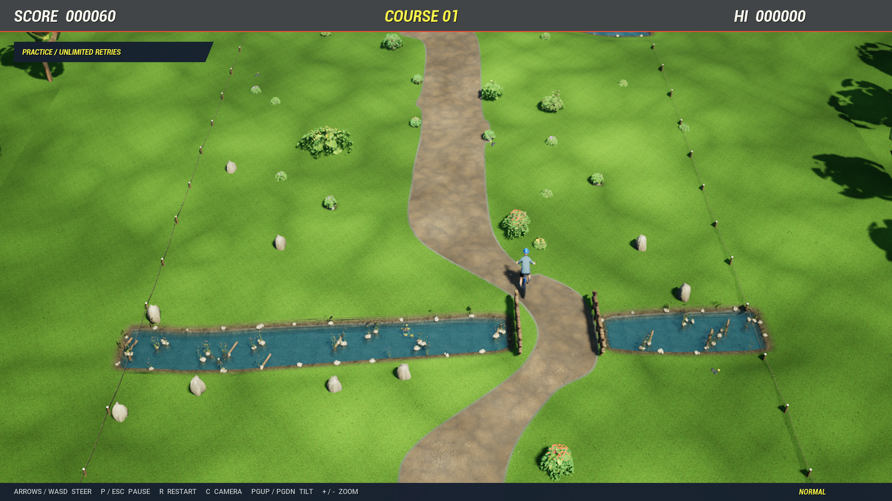
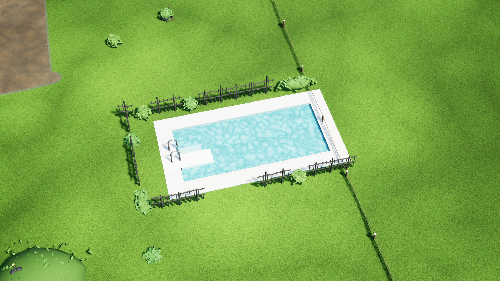
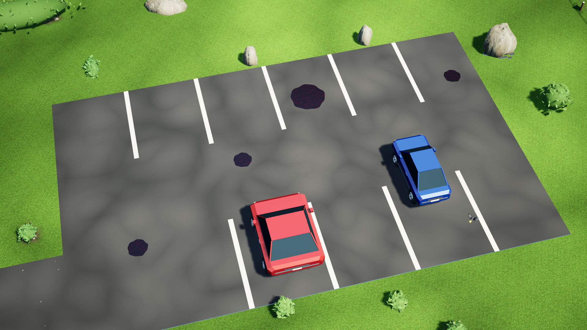
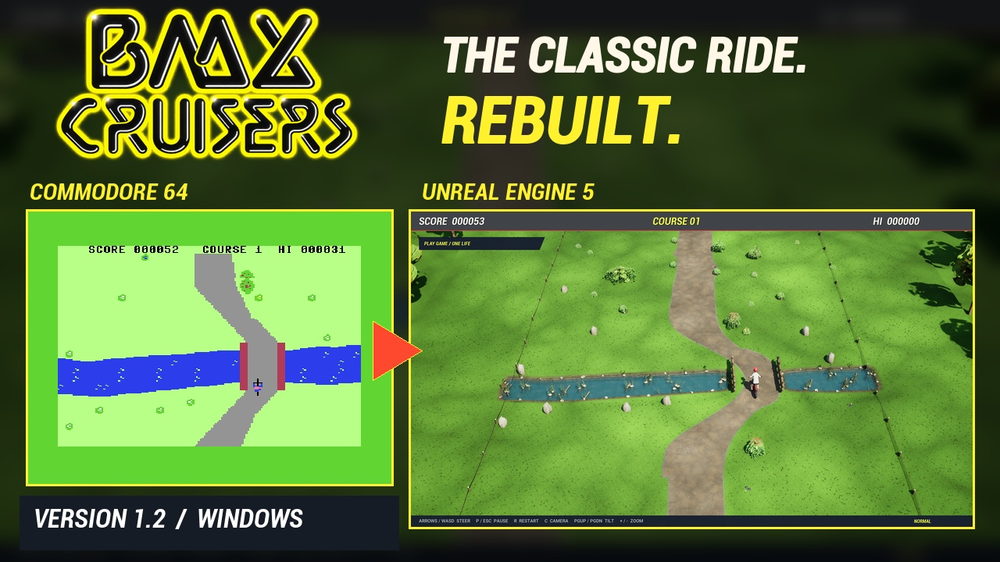
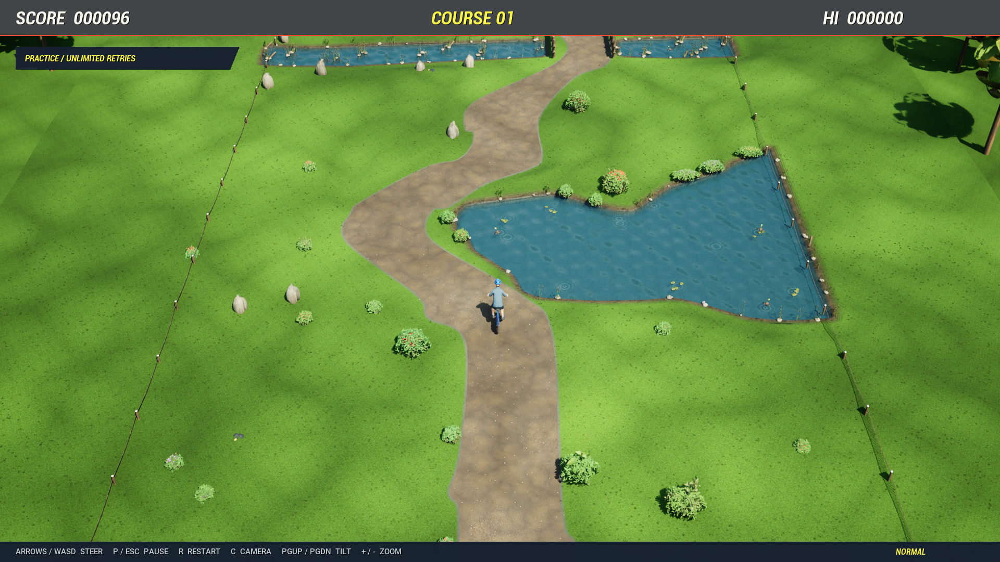
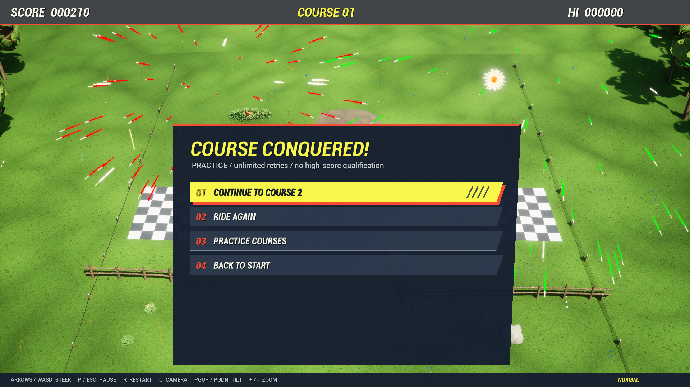

# BMX Cruisers — all five courses

A native Windows Unreal Engine 5.8.4 game that presents the recovered C64 logic for all five courses in a 3D park. The title is BMX Cruisers; the original BMX Racers is acknowledged in Credits.

Version 1.3 optimizes every graphics preset and restores the original swimming pools, parking areas, parked cars and oil slicks. All five courses, one-life play, unrestricted practice, controller riding, smooth shorelines, visible crashes and finish fireworks are included.

See [the restored-object table and verification notes](docs/ALL-COURSES.md#original-objects-restored-in-13) for the pools and car parks in the later courses.

The game defaults to DirectX 11 and a lightweight Performance preset with a sharper 900p scene, temporal reconstruction and a full-resolution interface. Prebuilt spatial mesh chunks and simpler lighting reduce work in every mode. Balanced and High retain more decoration and shadows, with optional 4K in High. Normal play is capped at 60 fps. See [performance measurements and validation limits](docs/PERFORMANCE.md).

[Download Windows 1.3](https://github.com/chjmartin2/bmx-cruisers/releases/tag/v1.3.0) · [Project website](https://retrocomputerist.com/projects/bmx-cruisers/) · [Release notes](CHANGELOG.md)

The trailer below shows version 1.2. It predates the graphics presets and restored pools and car parks. No new video accompanies 1.3.

[Watch the 1.2 trailer](https://www.youtube.com/watch?v=GMSA1Eg3nrI) · [Download 4K MP4](https://github.com/chjmartin2/bmx-cruisers/releases/download/v1.2.0/BMX-Cruisers-1.2-Trailer-4K.mp4) · [Download 1080p MP4](https://github.com/chjmartin2/bmx-cruisers/releases/download/v1.2.0/BMX-Cruisers-1.2-Trailer-1080p.mp4)

## Play

For the release ZIP, extract everything and run **BMXCruiser.exe**. See [installation, controls and limitations](docs/PLAY.md). In a development checkout, open **Play BMX Cruisers.cmd**. Keep the whole Windows build folder together. The compatibility launcher **Play BMX Cruiser.cmd** forwards to the new name.

The game supports a fitted desktop window and single-monitor borderless fullscreen. F11 toggles between them. Performance renders up to 900p, Balanced up to 1080p, and High offers 1080p or 4K without enlarging the desktop window or spanning multiple displays. A shared logical HUD layout preserves text and mouse alignment at different DPI settings and aspect ratios.

## Controls

| Action | Keyboard |
|---|---|
| Camera settings / live preview | C, or Camera View in the pause/settings menus |
| Camera tilt | Page Up / Page Down |
| Camera closer / farther | + / - |
| Restore default camera | Home |
| Menu selection | Up / Down / Tab |
| Adjust highlighted option | Left / Right |
| Confirm / start / retry | Enter / Space |
| Return / pause | Escape |
| Ride | Arrows / WASD |
| Pause | P |
| Restart ride | R |
| Music / effects | M / V |
| 1080p / 4K detail | 1 / 2 |
| Fullscreen | F11 |
| Screenshot | F9 |
| Garage orbit | Hold Q / E |
| Garage zoom | + / - |

Mouse actions and keyboard actions use the same menu routing. Ride with the left analog stick or D-pad as well as the keyboard. Xbox Menu/Start pauses and resumes; View/Back returns to the main menu and ends an active one-life run. The D-pad and controller A/B support menu navigation, with hints that follow the input device being used. Interactive rides pause when the game loses focus.

## Art and customization

The garage uses angular numbered racing plates, yellow/red highlights, a wire-grid backdrop, condensed italic typography, separate picture/sound settings and a lit rider preview. The main menu, instructions, pause/results and Credits use the same visual language.

Both riders support casual/extreme outfits, eight helmet/vehicle colors and seven independently saved skin tones. The six styles are cruiser, BMX, scooter, inline skates, quad skates and wheelchair. These choices affect rendering only. Speed, collision, score and course flow never read appearance settings.

The fitted head has a continuous tapered neck into the shirt collar. Full Extreme uses a full-face helmet with ear coverage, cheek padding, a molded chin guard, intake grille, separate visor, vents and retention hardware. Helmet color remains selectable.

The inline and quad skates now use authored material-separated boots, cuffs, liners, laces/stitches, alloy frames or trucks, polyurethane wheels, bearings/axles and toe stops. The scooter uses a shaped 53-cm deck, grip surface, neck/headset, fork, double clamp, grips, 110-mm wheels and rear brake. Helmets and protective guards are authored meshes as well. The skate assemblies follow the posed feet.

The skinned bodies are refined MIT Rocketbox derivatives (29,760 male / 34,928 female triangles). The detailed head is a 61,978-triangle neutral MetaHuman template bake with actual eye geometry, generated UV-aligned male/female skin atlases, pore normals and independent skin-tone materials. It is not a complete facial-animation MetaHuman rig. The packaged game uses standard static meshes and materials without creator services or a facial-animation plugin dependency.

The trail combines rotated/macro-blended scan layers with unique per-course cracks, repairs, drifting wear lines and dusty verges. These visual overlays preserve the original trail and obstacle footprints. The park also includes smooth visual shorelines, expanding ripples, wave normals, reeds/lily pads/driftwood/stones, birds and ducks, wind-driven foliage, gentle meadow relief, natural boundary markers, cloud shade, atmospheric depth and grit detail. Finish fireworks provide the celebration.

The recovered melody has a 48-kHz stereo electric-guitar arrangement alternating raspy and heavily overdriven phrases with bass and percussion. Authored rolling, nature, localized waterside, start/menu, crash/splash, guitar-finish and firework sounds supplement it. These are authored synthesis/foley-style effects rather than SID playback or field recordings. Music tempo is independent of ride pace.

## Original gameplay and timing

The source disk remains unchanged. SHA-256:
`9177346ca1e26f095f8f77ecd94d1bdbdf1496a5461a7d1f261fbe99f17c817e`.

The original screen sequence is **3, 4, 3, 5, 4, 6, 5, 7**. The source row loader determines the stream, including duplicated transition rows. Course completion fires at score/scroll 210. The exported view includes 24 initial rows and 209 inserted rows before the finish trigger.

The portable adapter executes recovered 6502 instructions. Modern play checks a common vehicle footprint at the displayed rider position against visible obstacles and interpolated shorelines, sweeping between frames to prevent tunneling. Shrub boundaries are inset from their outer leaves. Decorative wear and shoreline dressing are nonblocking. Original character/sprite masks remain available with `-OriginalCollision` for reference tests. The adapter implements the subset of VIC/CIA/Kernal services used by this game; it is not a complete cycle-exact C64 emulator. No Commodore system ROMs are included in the shipped game data.

Normal runs the original PAL instruction simulation at 1.0x. Cruise, Relaxed, Fast and Expert run it at 65%, 80%, 120% and 140%. Scores are stored separately for each pace. Changing pace during a paused ride applies on restart. Real elapsed time drives the simulation, so slow render frames do not silently slow the race.

Left/right steering keeps Normal's real-time movement rate at every pace. Slower modes give more time to avoid obstacles without sluggish steering; faster modes bring obstacles sooner without also accelerating steering. Normal's original movement and timing remain unchanged; contacts follow modern visible geometry. Up/down movement retains the original per-pace behavior. The finish checkerboard conforms to the meadow triangles with two centimetres of clearance; grass tufts are excluded around its edges.

A fresh VICE 3.10 measurement recorded 30 PAL rows: mean 0.10112843285 seconds per eight-pixel row. The native core and the older independent 20-row VICE fixture differ by roughly one percent. See `reference/extracted/timing-review.json`, `timing-fresh.json` and its monitor transcript. Changing the emulator's video-standard resource reset the machine; that attempted NTSC run is invalid and was not used for calibration.

The camera remains centered on the course during play at an elevated 40-degree angle; the rider moves freely within its wider frame. Continuous scroll reconstruction and rider animation smooth the source game's discrete row movement. Contact checks use this displayed position. A short Get Ready interval holds the race clock while course rendering settles. Ripple geometry is reused between frames and hidden fireworks are not animated during riding.

## Build and asset authoring

Use Unreal Engine 5.8 plus Microsoft C++ Build Tools 2022 and a Windows SDK. Run:

`tools/build.ps1 -EnginePath 'C:/Program Files/Epic Games/UE_5.8' -Package`

The repository includes the prepared project assets except editable Epic template derivatives. On a fresh checkout, the build restores the head from your installed UE 5.8 MetaHumanCharacter/MetaHuman plugins; these plugins must be installed. Raw downloaded authoring sources are excluded. A complete art regeneration with -PrepareAssets also requires the source files recorded in the asset manifests. The asset preparation commandlet imports scanned scenery, authored equipment and refined riders, constructs material graphs and saves the shared park level that the runtime dresses. The build prints the actual packaged Windows folder; use -Destination for a separate archive directory. The launcher detects the local 1.1 package or the default UAT Windows output. The project opens through `BMXCruiser.uproject`.

- `tools/author_equipment.py`: regenerate the OBJ/MTL equipment sources and inventory.
- `tools/refine_riders.py`: create refined FBX derivatives without altering the original avatar files.
- `tools/prepare_hero_head.py`: editor-only bake/import using the locally installed MetaHuman resources. Run with the MetaHumanCharacter and MetaHuman plugins enabled for that commandlet. Skin source PNGs/prompts are in `assets/source/hero`.
- `tools/smooth_course.py`: regenerate smooth visual contours and the meadow mesh using local NumPy, Shapely and mapbox-earcut.
- `tools/render_music.py`: regenerate the recovered-note guitar arrangement and sound effects.

The smooth road's area differs from the source raster by about two percent. The original route and instructions remain unchanged; water contacts use the same interpolated surface shown on screen. Shorelines use uniform-distance contour smoothing, a meadow clipped to the curve and a sloping grass-to-wet-soil blend. White boulders that were previously mistaken for dirt patches now have visible rock models.

## Verification

`tools/test-core.cmd` checks the portable core: neutral collision at score 53, steering observations, render-rate-independent input, the original finish routine, and a complete collision-enabled replay at all five paces. It also checks continuous scroll presentation at 30/60/120 Hz. `tools/test-display.cmd` checks single-monitor bounds, DPI scaling, safe HUD bounds and click mapping.

`tools/verify-crashes.ps1` runs real packaged boulder and water contacts at Normal, Cruise and Expert (including 4K). It verifies the 1.8-second crash presentation, blocked restart/menu actions during impact, frozen simulation cycles and score, and the correct practice/campaign result controls. It preserves player save and display settings.

`tools/verify-crashes.ps1 -OnlyBridge` replays a deliberate Course One guardrail strike, checks a solid impact at score 127 and verifies the crash sequence. `-VerifyContacts` also probes interior bridge rails on every selected course, plus both rail strikes, a close parallel pass and an open centre lane on Course One. The pre-repair completion fixtures in `tests/replays/visible` clip some restored rails; they need re-recording before claiming a full rendered campaign replay pass with the repaired contacts. Native core completion checks remain separate.

`tools/verify-living-park.ps1 -Name workshop-final` runs the actual packaged game: all six appearance invariants, all seven skin tones on both avatars, and complete Normal/Expert replays including native 4K. Appearance rebuilds must preserve every byte of simulation RAM, its cycle count and run state.

Useful development flags:

- `-VerifyCosmetics -AutoQuit=16 -RenderOffscreen`: six equipment captures and invariants.
- `-VerifySkinTones -AutoQuit=25 -RenderOffscreen`: fourteen skin/gender captures and invariants.
- `-ReplayFile="absolute/path/to/course1-completion-replay.json" -AutoQuit=28`: collision-enabled route.
- `-MenuPage=0..5 -CaptureMenu`: startup, instructions, main, garage, Credits, settings.
- `-Style=0..5 -Gender=0..1 -SkinTone=0..6 -Outfit=0..1`: preview overrides.

Actual runtime screenshots and validation reports are saved under `preview`. Earlier AI concept previews are art references, not executable screenshots. Mobile/iOS builds are not implemented.

Asset provenance and licenses: [assets/CREDITS.md](assets/CREDITS.md). Additional art-pass details: [docs/ART-PASS-04.md](docs/ART-PASS-04.md).

### Course-following camera

The riding camera follows the course scroll at a fixed lateral center. Up/Down moves the rider through the frame as on the C64; Left/Right also remains visible within the trail width. The default elevated 40-degree view uses a 52-degree field of view, 23 metres behind the scroll origin and 24.5 metres above it. Players can set tilt from 30 to 75 degrees and distance from 90% to 140%, in five-unit steps. C opens a live course preview and pauses an active ride; the same controls are in Picture & Sound and the pause menu. Page Up/Page Down, +/-, and Home also work during a ride. Tilt and distance are saved independently of character customization. Garage orbit and zoom are independent.

## All five courses (1.1)

Play Game starts at Course One with one life. A crash ends the run, and restarting returns to Course One. Continue through all five courses in order on the same pace to qualify for the High Score Board. Practice Courses opens any course with unlimited retries and cannot qualify for that board. Existing course practice scores are retained separately; older records that allowed retries are excluded from the new board.

The original row loader and finish routine determine the course boundaries and native movement settings. Finish scroll counts are 210, 250, 375, 500 and 625. The later stages begin with the actual post-finish screen and loader state recovered from the original. The HUD score carries forward when continuing between courses; direct selection starts a new score. Per-course records remain separate.

Run tools/export_all_courses.py to recover the later courses and regenerate their smooth visuals. Run tools/verify-all-courses.ps1 to exercise all five packaged courses and every next-course transition using collision-enabled replays. Supply -BuildPath and -ReplayDirectory for a custom packaged folder and modern-geometry fixtures. The version 1.2 trailer opens with authentic C64 emulator footage and shows the earlier 1.2 Windows presentation. The archived 1.0 trailer shows the earlier Course One release.
